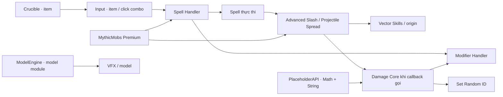

# IonTech Modular Systems

Bản nhập có 84 YAML, gồm 59 file skill, 13 mob, 10 item, `packinfo.yml` và `placeholders.yml`. Bộ đọc tĩnh nhận 423 khai báo metaskill, 22 mob, 28 item và 14 mục dạng mapping trong placeholders. Số khai báo tính cả ID trùng. Các nhóm dưới đây có thể chồng nhau. [README tác giả](../../incoming/IonTech/IonTech-s-Modular-Systems-main/README.md) · [Hướng dẫn cài gốc](../../incoming/IonTech/IonTech-s-Modular-Systems-main/README.txt) · [LICENSE](../../incoming/IonTech/IonTech-s-Modular-Systems-main/LICENSE)

Nhãn kiểm kê theo file gồm Input Handlers (9), Spell Handlers (11), Damage Systems (5), Vector/Math (4), Variables (53), Projectile (15), Slash (10), Modifiers (4), VFX (7), Demo (23), Deprecated (9), Incomplete có đánh dấu trực tiếp (1) và Support (17). Xem đường dẫn, ID, SHA-256 và nhãn từng file trong JSON theo đợt. [Tổng hợp máy đọc](iontech-dependencies.json)

| Đợt | Phạm vi | Kết quả đọc |
| --- | --- | --- |
| 01 · 3 YAML | Vector, Knockback, insertion sort | [Vector và cự ly](../advanced-math/vectors.md) · [Variables và sort](../advanced-variables/README.md) · [Kiểm kê](iontech-01-vector-math-variables.json) |
| 02 · 8 YAML | Advanced Slash, spread, VFX và các demo projectile | [Slash và Projectile](slash-projectile.md) · [Hình học](../advanced-math/geometry.md) · [Kiểm kê](iontech-02-slash-projectile.json) |
| 03 · 6 YAML | Spell, Damage, Modifier, Click Combo | [Luồng handler](handlers.md) · [Kiểm kê](iontech-03-handlers.json) |
| 04–06 · 67 YAML | Item, mob hỗ trợ, demo, mã deprecated và phần còn lại | [04](iontech-04-inventory.json) · [05](iontech-05-inventory.json) · [06](iontech-06-inventory.json) |

[Checkpoint kiểm kê](iontech-checkpoint.json) ghi danh sách file theo đợt. [Checkpoint phân tích](iontech-study-checkpoint.json) ghi tài liệu và phần còn cần làm. [Đồ thị metaskill](iontech-dependencies.json) giữ cạnh có tên literal, đường dẫn và ứng viên định nghĩa.

## Đồ thị module

Cạnh trong sơ đồ thể hiện đường gọi quan sát ở một số cấu hình hoặc phụ thuộc theo README, có thể đi qua ID động. Không phải mọi spell gọi Slash hay Damage Core. Đồ thị tự động có 468 cạnh ứng viên và 19 cạnh chưa ghép ID. Một số cạnh là giá trị cấu hình bị biểu thức nhận nhầm (ví dụ `false`/ `true` trong callback), tên nằm trong đoạn đánh dấu đặc biệt, hoặc callback cần truy thủ công. Kiểm tra `particle_shockwave` được khai báo trong hai file và alias sang `particle_spiral` chưa tìm thấy định nghĩa trùng tên. Không suy ra file nào thắng khi nạp. [Bản VFX Spiral](../../incoming/IonTech/IonTech-s-Modular-Systems-main/packs/IonTech's%20Modular%20Systems/skills/Game%20Mechanic%20Skills/Skill%20Mechanics/particle_spiral-vfx.yml#L19) · [Bản VFX Shockwave](../../incoming/IonTech/IonTech-s-Modular-Systems-main/packs/IonTech's%20Modular%20Systems/skills/Game%20Mechanic%20Skills/Skill%20Mechanics/particle_shockwave-vfx.yml)

## Phụ thuộc và cảnh báo

- Tác giả yêu cầu MythicMobs Premium bản mới nhất theo thời điểm viết, Crucible cho item, ModelEngine cho module có model và PlaceholderAPI với Math/String. `packinfo.yml` chỉ ghi tên, không ghi version/build. Các yêu cầu cấu hình ArmorStand/Marker và String replacements thuộc hướng dẫn cài pack. Phân tích này dùng 5.14.0 làm mốc đọc wiki, build tương thích của pack chưa được xác minh. [Cấu hình pack](../../incoming/IonTech/IonTech-s-Modular-Systems-main/packs/IonTech's%20Modular%20Systems/packinfo.yml) · [Yêu cầu gốc](../../incoming/IonTech/IonTech-s-Modular-Systems-main/README.txt)
- **DEPRECATED:** 9 YAML dưới `Deprecated Skills`, gồm Spell Handler cũ, các biến thể Slash, Channel và Mob AI. Dùng cho khảo cứu, ưu tiên API hiện hành khi thiết kế ca mới. [Kiểm kê đợt 05](iontech-05-inventory.json)
- **INCOMPLETE:** Scatter được tác giả đánh dấu chưa xong. Click Combo có ghi chú DROP trả về LEFT. `particle_shockwave` có khai báo trùng và một alias chưa tìm được đích. [Scatter](../../incoming/IonTech/IonTech-s-Modular-Systems-main/packs/IonTech's%20Modular%20Systems/skills/Game%20Mechanic%20Skills/Skill%20Mechanics/projectile-skills.yml#L82) · [Click Combo](../../incoming/IonTech/IonTech-s-Modular-Systems-main/packs/IonTech's%20Modular%20Systems/skills/Game%20Mechanic%20Skills/Input%20Mechanics/click_combo-mechanic-skills.yml#L1)
- **HIGH_RISK:** Tác giả cảnh báo modifier tự gọi trong modifier có thể gây lỗi nghiêm trọng. Demo Fractal có fan-out 3–5 theo `onEnd`, depth demo 1048 và nhiều `setblock`. Không suy ra số projectile thực từ biến depth vì còn phụ thuộc scope/callback. [README tác giả](../../incoming/IonTech/IonTech-s-Modular-Systems-main/README.md) · [Demo Fractal](../../incoming/IonTech/IonTech-s-Modular-Systems-main/packs/IonTech's%20Modular%20Systems/skills/Demo%20Skills/fractal.yml)
- LICENSE dùng văn bản Unlicense, công bố public domain và cung cấp phần mềm theo hiện trạng. README nói tài liệu ít, Vector phù hợp làm nguồn tham khảo. Chưa có bằng chứng chạy pack hoặc xác nhận các demo trên server này.

Công cụ kiểm kê `tools/index_iontech.py` chỉ đọc source và ghi chỉ mục. `syntax-checked` chỉ xác nhận parser YAML. File chỉ có comment vẫn hợp lệ ở bước đó nhưng không đăng ký skill. [Điều tra ID VFX trùng](../../feedback/corrections/MM-2026-007.md)
