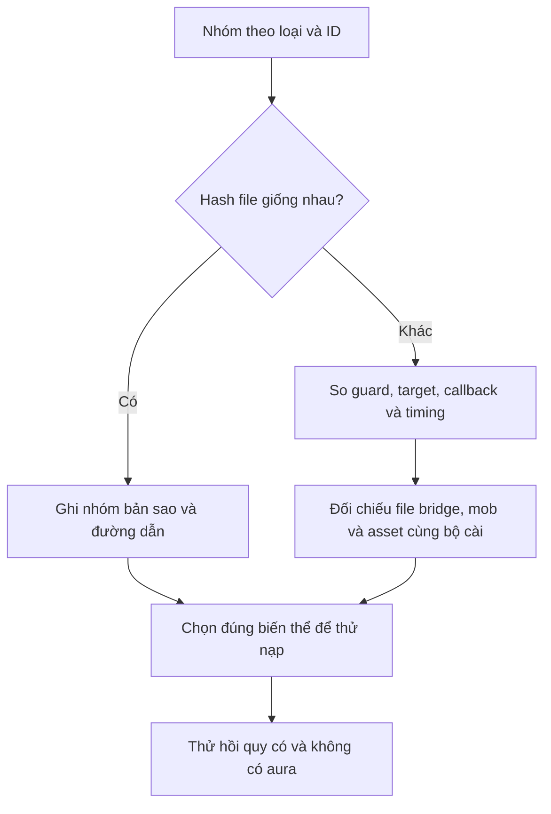

# Quản lý biến thể cấu hình dùng chung ID

Dùng hash để nhận ra bản sao, rồi so hành vi theo ID trước khi chọn biến thể để nạp hoặc tối ưu. Ví dụ là bốn bản **Arctic Knight** trong các bộ cài khác nhau.

## Khi dùng và khi tránh

- Dùng khi cùng một mob/skill xuất hiện trong nhiều pack, bản sao server hoặc bản chỉnh sửa. Đặc biệt hữu ích nếu cần học từ bản gần nhất với server thực.
- Tránh hợp nhất chỉ vì cùng tên file hoặc ID. Một thay đổi nhỏ ở condition, duration hoặc callback có thể đổi luật cast. Với các bộ cài độc lập, giữ provenance của từng bản để tái hiện kết quả.

## Luồng thực thi



**INFERENCE.** Bỏ guard aura trong CaRiMC có thể mở đường cast ngoài form. Việc đó còn phụ thuộc guard ở caller và registry đã nạp. Khi so biến thể, đi từ entry tới đúng skill con rồi so các điều kiện và cooldown của từng nhánh. [CaRiMC BreakDown](../../incoming/no-model/MythicMobsCariMc/MythicMobs/skills/ArcticKnight.yml#L135), [Đối chiếu đợt 01](../dataset-batch-01.md#arctic-knight)

## Thành phần

- **FACT · YAML và hash.** Bốn bản mob clone giống byte. Bốn file skill dùng cùng 33 ID, có ba hash. Ở bản tác giả, `ARCTIC_KNIGHT_BreakDown` và Ice Rain có guard `hasaura arcticknight`. CaRiMC comment hai guard này. BreakDown gọi metaskill lặp và có nhánh damage chọn `@EIR`. Cặp IgnisArctic/AllClass dùng cùng hash và có biến thể duration dựa trên modifier. [Bản tác giả](../../incoming/no-model/0-NOOB123okPackCreator/PackArcticKnight%20-%20NOOB123ok/MythicMobs/Skills/ArcticKnight.yml#L135), [IgnisArctic](../../incoming/no-model/fullclass/0_VipClass/IgnisArctic/MythicMobs/Skills/ArcticKnight.yml#L25), [Chỉ mục dataset](../dataset-index.md)
- **FACT · wiki.** ID nội bộ được dùng để gọi metaskill. Điều kiện caster và kế thừa target quyết định việc nhánh skill áp dụng ở đâu. [Metaskills](https://wiki.mythiccraft.io/mythicmobs/Skills/Metaskills?version_id=9b056129fdf1d2b9787ddb14bfbb6380ccce3078), [Conditions](https://wiki.mythiccraft.io/mythicmobs/Skills/Conditions)

## Ưu, nhược điểm và rủi ro

- **INFERENCE.** Hash giảm công đọc lại bản sao, còn diff theo ID giúp nhìn ra guard thay đổi. Hash khác vẫn có thể chỉ khác comment hoặc định dạng. So cả dòng active và bộ cài tương ứng.
- **INFERENCE.** Nạp các biến thể có ID lặp vào cùng registry có thể làm phiên bản dùng lúc chạy khó xác định. Bỏ một guard cũng có thể tăng tần suất projectile hoặc hiệu ứng. Kiểm tra build, modifier và log nạp, rồi đo số cast, hit và MSPT trước/sau theo cùng kịch bản.

## Trích YAML gốc

```yaml
ARCTIC_KNIGHT_BreakDown:
  Conditions:
  - hasaura arcticknight true
  Cooldown: 1
```

[Guard trong bản tác giả](../../incoming/no-model/0-NOOB123okPackCreator/PackArcticKnight%20-%20NOOB123ok/MythicMobs/Skills/ArcticKnight.yml#L135)

## Xác minh và phương án khác

**FACT · bằng chứng.** Tám YAML Arctic đạt `syntax-checked`. Đã đối chiếu hash, ID và diff guard. Chưa xác nhận bản nào đang nạp trên server hay hệ quả của guard. Cầu nối còn ở hàng chờ đợt sau. [Báo cáo Arctic](../dataset-batch-01.md#arctic-knight)

**INFERENCE · phương án.** Nếu các biến thể phục vụ những server khác nhau, giữ mỗi bộ riêng và lưu build kèm theo. Nếu cần chạy đồng thời, xác định namespace và cập nhật tất cả caller trước khi thử trên bản sao. Chỉ cân nhắc gom các biến thể khi diff và test chứng minh cùng hành vi cho các ca cần giữ.
