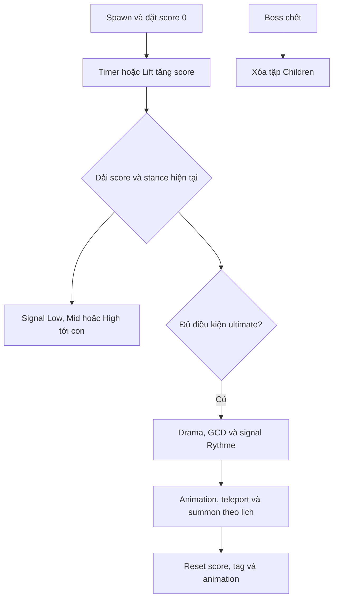

# Phase boss theo score, stance và signal

Dùng score để biểu diễn tiến độ trong trận, stance để biểu diễn chế độ hiện tại và signal để các mob phụ đổi hành vi. Ví dụ là **Conductor** trong Hollow Woods Vol.2.

## Khi dùng và khi tránh

- Dùng khi phase phụ thuộc nhiều sự kiện, có mob phụ cần phản ứng và có đoạn ultimate hoặc chuyển cảnh riêng.
- Tránh khi boss chỉ đổi một đòn ở một ngưỡng HP hoặc khi luật của trận cho phép đánh giá độc lập mỗi lần cast. Với nhiều boss cùng map, xác định trước cách cô lập marker, score và add của từng trận.

## Luồng thực thi

**INFERENCE.** Spawn khởi tạo score `drama`. Timer khi có target trong 24 block và signal `Lift` tăng score. Các metaskill theo dải score xét stance hiện tại trước khi phát signal đến con. Ultimate có guard score/target và cooldown, gắn tag, đặt GCD, phát signal và xếp lịch summon. Cuối chuỗi, skill reset score, tag và state. Đường chết của boss xóa `@Children` qua một trigger riêng. [Mob Conductor](../../incoming/no-model/MythicMobsCariMc/MythicMobs/packs/PixelBarrel%27s%20Hollow%20Woods%20Vol.2/Mobs/Conductor.yml#L15), [Các nhánh phase](../../incoming/no-model/MythicMobsCariMc/MythicMobs/packs/PixelBarrel%27s%20Hollow%20Woods%20Vol.2/Skills/Conductor_skills.yml#L33)



## Thành phần

- **FACT · YAML.** Có `modifytargetscore`, `setstance`, `signal`, `addtag/removetag`, `gcd`, `summon`, `state`, `submodel`. Điều kiện gồm `score`, `stance`, `targetwithin`, `hastag` và `offgcd` ở các nhánh áp dụng. Targeter gồm `@Self`, `@Children` và `@MobsInRadius` cho marker teleport. [Ultimate](../../incoming/no-model/MythicMobsCariMc/MythicMobs/packs/PixelBarrel%27s%20Hollow%20Woods%20Vol.2/Skills/Conductor_skills.yml#L196)
- **FACT · wiki.** `signal` cần trigger nhận tương ứng. `gcd` đặt cooldown toàn cục của caster, phối hợp với `offgcd` để khóa các skill có kiểm tra này. [Signal](https://wiki.mythiccraft.io/mythicmobs/skills/mechanics/signal?version_id=b0869d9e4e806a13ce3551996e02f3a3600b50a9), [GlobalCooldown](https://wiki.mythiccraft.io/mythicmobs/skills/mechanics/globalcooldown)

## Ưu, nhược điểm và rủi ro

- **INFERENCE.** Score tích lũy được từ nhiều nguồn, stance giảm việc gửi lại cùng tín hiệu. Đổi lại, phải quản lý các giá trị biên, đồng bộ trạng thái boss/add và reset nếu chiêu bị ngắt. Đo score 90, 91, 92, 119 và 120, cùng trường hợp add xuất hiện sau lần gửi signal. Test hai boss trong phạm vi marker của nhau.
- **INFERENCE.** Các timer, projectile ring của Vioar và hai loạt summon có thể tạo tải chồng nhau. Model, âm thanh custom và hành vi scoreboard phụ thuộc môi trường. Chevaliers spawn bằng lệnh cần được kiểm tra có thuộc tập `@Children` lúc cleanup hay không. Một helper có tham chiếu chưa tìm thấy đích trong đợt. [Hồ sơ tham chiếu Conductor](../../feedback/corrections/MM-2026-002.md)

## Trích YAML gốc

```yaml
Conductor_DramaMeter_Signal-Mid:
  Conditions:
  - score{objective=drama;value=31to90}
  - stance{s=Mid} cancel
  Skills:
  - signal{s=Mid} @Children
  - setstance{s=Mid} @Self
```

[Nhánh Mid trong file gốc](../../incoming/no-model/MythicMobsCariMc/MythicMobs/packs/PixelBarrel%27s%20Hollow%20Woods%20Vol.2/Skills/Conductor_skills.yml#L62)

## Xác minh và phương án khác

**FACT · bằng chứng.** Pack metadata ghi 1.0.0, bốn YAML đạt `syntax-checked`. Build MythicMobs/ModelEngine và gameplay chưa có bằng chứng. Cần thử chuyển dải, reset, chết/despawn giữa ultimate, add còn sót và tách trạng thái hai boss. [Báo cáo Conductor](../dataset-batch-01.md#conductor)

**INFERENCE · phương án.** Dùng condition HP nếu gameplay thực sự đổi theo HP và có thể quay lại phase cũ. Dùng biến caster và chuyển trạng thái rõ nếu phase chỉ tiến, phải chống lặp hoặc cần giữ trạng thái giữa nhiều trigger. Chọn score cộng dồn khi sự kiện trong trận phải đóng góp vào nhịp chuyển phase. [Boss phases theo HP](../architecture/boss-phases.md)
