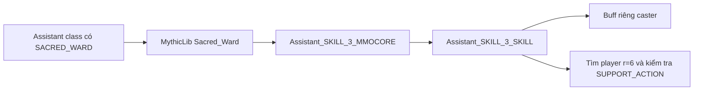

# Điểm vào player skill qua MMOCore và MythicLib

Truy đường thực thi từ class hoặc skill người chơi tới đúng metaskill và đúng nguồn modifier. Ví dụ **Sacred Ward** trong class Assistant.

## Khi dùng và khi tránh

- Dùng khi class, cấp skill, chi phí hoặc modifier của người chơi thuộc MMOCore/MythicLib và combat được viết bằng MythicMobs.
- Tránh thêm cầu nối nếu mechanic chỉ được mob gọi và không dùng registry người chơi, modifier MMO hay chính sách tương tác của MythicLib.

## Luồng thực thi



**INFERENCE.** Theo đường ánh xạ trong YAML, entry được gọi trực tiếp từ bridge là `Assistant_SKILL_3_MMOCORE`, rồi tới nhánh có cooldown 9. Nhánh aura ngắn `Assistant_SKILL_3` là một entry khác. Cần xác nhận cách chuẩn hóa ID, giá trị modifier và thứ tự cooldown phía class so với metaskill trên build thực tế. [Class](../../incoming/no-model/fullclass/0_VipClass/Assistant/MMOCore/classes/Assistant.yml#L22), [Metaskill entry](../../incoming/no-model/fullclass/0_VipClass/Assistant/MythicMobs/Skills/AssistantSkill.yml#L92)

## Thành phần

- **FACT · wiki.** Phoenix mô tả registry custom skill và tích hợp MythicMobs, bao gồm modifier và điều kiện `mmoCanTarget`. Tài liệu cấu hình MMOCore hiện mô tả trigger passive ở class hoặc MythicLib. [Tích hợp MythicMobs](https://docs.phoenixdevt.fr/mythiclib/skills/custom/mythic), [MMOCore Skill Configuration](https://docs.phoenixdevt.fr/mmocore/skills/config.html)
- **FACT · YAML.** Sacred Ward ánh xạ `mythicmobs-skill-id` cùng `duration` và `elv`. Luồng thực thi dùng `skill`, `potion`, `@self`, `@PIR` và `TargetConditions` với `SUPPORT_ACTION`. `Holy Cry` là ca so sánh riêng vì file skill dùng khóa `passive-type: TIMER`. [Cầu nối](../../incoming/no-model/fullclass/0_VipClass/Assistant/Mythiclib/skill/AS_ML_SKILL.yml#L14), [Buff target](../../incoming/no-model/fullclass/0_VipClass/Assistant/MythicMobs/Skills/AssistantSkill.yml#L262), [Holy Cry](../../incoming/no-model/fullclass/0_VipClass/Assistant/MMOCore/Skills/holy-cry.yml#L11)

## Ưu, nhược điểm và rủi ro

- **INFERENCE.** Cầu nối giữ cấu hình level và thi hành combat có thể kiểm tra riêng. Nhiều registry làm tăng khả năng sai ID hoặc bỏ sót modifier. Test đúng entry từ class và kiểm tra các lớp cooldown cùng thời điểm bắt đầu tính.
- **INFERENCE.** Hai lớp lặp buff/VFX có thể cùng tăng theo duration. Kiểm tra ally, người ngoài party, chi phí cast và FPS khi nhiều caster. Xác nhận phiên bản trước khi đổi từ `mythicmobs-skill-id` sang dạng `source` của tài liệu hiện tại.

## Trích YAML gốc

```yaml
Sacred_Ward:
  mythicmobs-skill-id: Assistant_SKILL_3_MMOCORE
  modifiers:
  - duration
  - elv
```

[Cầu nối gốc](../../incoming/no-model/fullclass/0_VipClass/Assistant/Mythiclib/skill/AS_ML_SKILL.yml#L14)

## Xác minh và phương án khác

**FACT · bằng chứng.** Bảy file Assistant đạt `syntax-checked`, các ID class, skill và metaskill được đối chiếu tĩnh. Chưa có log registry hoặc bằng chứng cast từ MMOCore. [Báo cáo Assistant](../dataset-batch-01.md#assistant)

**INFERENCE · phương án.** Dùng entry MythicMobs trực tiếp cho mob/utility không cần registry MMO. Với kỹ năng người chơi cần tích hợp, dùng cách khai báo được build thực tế hỗ trợ. Cầu nối Lục Cốt cho một mẫu dùng `source: mythicmobs:…` để so sánh cấu trúc. [Cầu nối Lục Cốt](../../incoming/Tutien/luccotchivuong/lccv_mythiclib.yml#L41)
