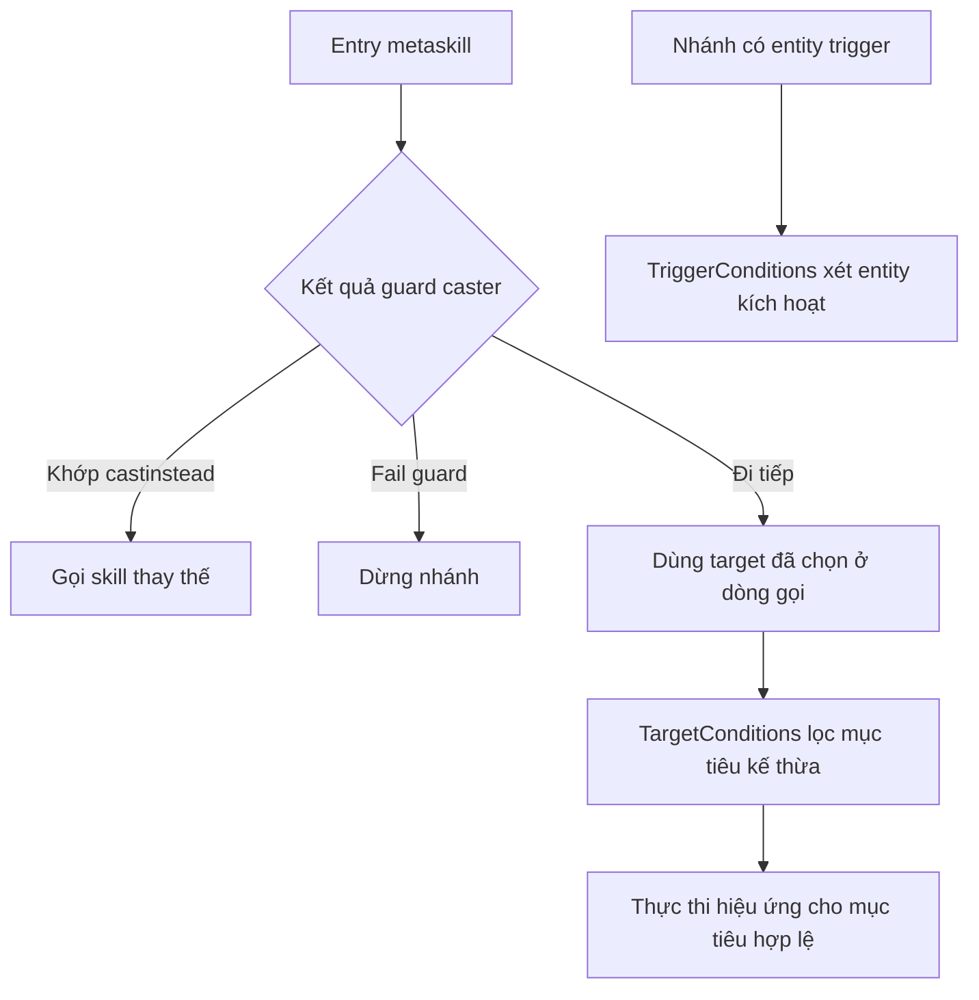

# Điều kiện theo caster, target và trigger

Đặt mỗi guard ở ngữ cảnh của đối tượng cần xét. Ví dụ **Lục Cốt Chi Vương** dùng điều kiện caster để chọn nhánh, **Sacred Ward** lọc từng người nhận buff và **Xích Huyết** xét chủ sở hữu trong `TriggerConditions` khi thu hồi thương.

## Khi dùng và khi tránh

- Dùng khi một skill có nhiều nhánh theo form, trạng thái hoặc quyền tương tác, hay khi nhiều mục tiêu cùng nằm trong phạm vi.
- Tránh đặt guard dài trong một dòng inline khi có nhiều nhánh cần đọc và thử riêng. Khi cần bảo đảm trạng thái vẫn hợp lệ lúc hit, đặt guard ở bước thực hiện sau delay theo đúng đối tượng cần xét.

## Luồng thực thi



**INFERENCE.** Với Lục Cốt, guard form quyết định có chạy đòn hay không, và aura hai tay chuyển sang nhánh khác. Sacred Ward dùng vùng r=6 làm tập ứng viên và `SUPPORT_ACTION` cho từng người nhận. Khi đổi từ chọn vùng sang target riêng hoặc thay vị trí guard, kiểm tra lại thứ tự lọc và các nhánh override target. [Lục Cốt](../../incoming/Tutien/luccotchivuong/lccv_skills.yml#L2), [Sacred Ward](../../incoming/no-model/fullclass/0_VipClass/Assistant/MythicMobs/Skills/AssistantSkill.yml#L251)

## Thành phần

- **FACT · wiki.** `Conditions` xét caster, `TargetConditions` xét target kế thừa, `TriggerConditions` xét entity trigger. `castinstead` chọn skill thay thế khi điều kiện khớp. Skill con có thể khai báo targeter riêng, vì vậy cần theo dấu tới dòng thực thi cuối. [Conditions](https://wiki.mythiccraft.io/mythicmobs/Skills/Conditions), [Targeters](https://wiki.mythiccraft.io/mythicmobs/Skills/Targeters)
- **FACT · YAML.** Các guard gồm `hasAura`, `varEquals`, `mmoCanTarget`, `owner`. Các dòng gọi dùng `skill` hoặc `SudoSkill`. `@PIR` chọn người trong tầm của Sacred Ward, buff bản thân dùng `@self` ở nhánh riêng. `SUPPORT_ACTION` và `OFFENSE_ACTION` là ngữ cảnh kiểm tra khác nhau của MythicLib. [Sacred Ward nhận buff](../../incoming/no-model/fullclass/0_VipClass/Assistant/MythicMobs/Skills/AssistantSkill.yml#L262), [Recall](../../incoming/Tutien/xichhuyetphathienthuong/xichhuyetthienthuong_skill.yml#L218), [MythicLib](https://docs.phoenixdevt.fr/mythiclib/skills/custom/mythic)

## Ưu, nhược điểm và rủi ro

- **INFERENCE.** Guard tách theo vai trò giúp test caster, trigger và từng target độc lập. Đổi scope, dùng `SudoSkill` hoặc đổi entry có thể làm một condition xét người khác với dự kiến. Với timer và chuỗi lặp, thử tập mục tiêu rỗng, đồng minh, đối thủ và một người rời phạm vi trong lúc lặp.
- **FACT · tương thích.** Wiki đánh dấu inline target conditions trên targeter là Premium. Với các YAML cũ, kiểm tra dạng inline và edition trên build đã ghi. [Inline Conditions](https://wiki.mythiccraft.io/mythicmobs/Skills/Inline-Conditions)
- **INFERENCE · hiệu năng.** Khi lọc nhiều người theo nhịp ngắn, đo riêng số ứng viên, số target hợp lệ và số lần callback. Giảm tần suất chỉ khi cửa nhận hoặc mất hiệu ứng vẫn khớp yêu cầu.

## Trích YAML gốc

```yaml
  TargetConditions:
  - mmoCanTarget{interaction=SUPPORT_ACTION} true
```

[Guard gốc trong Assistant_SKILL_3_D](../../incoming/no-model/fullclass/0_VipClass/Assistant/MythicMobs/Skills/AssistantSkill.yml#L262)

## Xác minh và phương án khác

**FACT · bằng chứng.** YAML đợt 01 đạt `syntax-checked`. Cạnh từ Sacred Ward tới skill con được đối chiếu. Chưa có kết quả phân phe, thay đổi scope hay xử lý target rỗng trong game. [Báo cáo Assistant](../dataset-batch-01.md#assistant)

**INFERENCE · phương án.** Dùng metaskill có tên với `TargetConditions` khi bộ lọc dùng lại hoặc cần log dễ. Dùng điều kiện tại một dòng khi guard ngắn và build hỗ trợ. Dùng guard tại hit nếu quan hệ hoặc trạng thái có thể thay đổi giữa lúc chọn ứng viên và lúc tác động.
