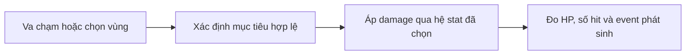

# Chọn hitbox và đường áp damage

Dùng khi cần đo đúng ai trúng, bao nhiêu lần và mất bao nhiêu HP. Với đòn một mục tiêu, ưu tiên target kế thừa từ hit. Với AoE có tâm rõ, chọn lại entity quanh tâm và xét phe tại nhánh damage.

**FACT.** Fishball gọi `damage{a=2;pkb=true}` trong callback hit. SkyFall của Xích Huyết có cả callback hit dọc đường và AoE ở end, mỗi nhánh có dòng `mmodamage` riêng. Wiki phân biệt cờ bỏ qua giáp, khiên, resistance và cửa miễn nhiễm. Phoenix mô tả `mmodamage` tích hợp hệ stat/damage của MythicLib. [Fishball](../../incoming/no-model/MythicMobsCariMc/MythicMobs/packs/PixelBarrel%27s%20Hollow%20Woods%20Vol.2/Skills/Conductor_skills.yml#L119), [SkyFall](../../incoming/Tutien/xichhuyetphathienthuong/xichhuyetthienthuong_skill.yml#L176), [Damage](https://wiki.mythiccraft.io/mythicmobs/Skills/Mechanics/damage), [MythicLib](https://docs.phoenixdevt.fr/mythiclib/skills/custom/mythic)

**INFERENCE.** Hai callback có thể đánh cùng một target nếu đường bay và AoE giao nhau. Chọn một đường damage nếu gameplay chỉ yêu cầu một hit. Nếu hai hit là chủ ý, thử cả hai nhánh, tường, khiên, giáp, ally và hai caster cùng lúc. Đo chi phí quét và event khi vùng đông entity. Cấu hình chỉ đạt `syntax-checked`. [Báo cáo đợt 01](../dataset-batch-01.md#xích-huyết-phá-thiên-thương)
