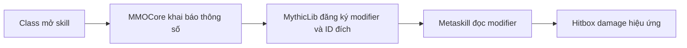

# Đối chiếu modifier từ cấu hình class đến hitbox

Dùng khi cùng một skill có lore, bảng tăng theo level, đăng ký MythicLib và metaskill MythicMobs. Khi chỉ có một cast nội bộ với thông số cố định, giữ giá trị ở metaskill giúp giảm số nơi cần đối chiếu.

**FACT · cấu hình.** Break Down khai báo `radius` ở MMOCore, và `noob.yml` chuyển `radius` cùng `damage` và `duration`. Metaskill dùng `radius` trong biểu thức blockmask, còn các targeter ở nhánh damage và freeze ghi bán kính cố định. Clone có cả cấu hình thông số và metaskill, nhưng class và bảng đăng ký đã đọc không có mục Clone. [Thông số Break Down](../../incoming/no-model/fullclass/0_VipClass/IgnisArctic/MMOCore/Skills/arctic-knight-break-down.yml#L13), [Đăng ký MythicLib](../../incoming/no-model/fullclass/0_VipClass/IgnisArctic/Mythiclib/skill/noob.yml#L18), [Metaskill](../../incoming/no-model/fullclass/0_VipClass/IgnisArctic/MythicMobs/Skills/ArcticKnight.yml#L141)

**INFERENCE · lựa chọn.** Nếu level chỉ tăng kích cỡ trang trí, mô tả riêng vùng hiệu ứng và vùng gây sát thương. Nếu level cần tăng tầm trúng, đối chiếu từng targeter liên quan trên build mục tiêu trước khi chia sẻ thông số giữa các nhánh. Nếu skill chỉ tăng damage, một hitbox cố định dễ cân bằng hơn. Việc chuẩn hóa một nguồn thông số giảm lệch giữa lore và metaskill, đổi lại cần kiểm tra modifier có mặt ở tất cả các entry, kể cả item hoặc lần gọi trực tiếp không qua class.

**Kiểm chứng.** Đã parse YAML và khớp tên các ID đích theo chữ thường. Thử hai level với mục tiêu đặt ở rìa từng bán kính, ghi lượng máu mất và vùng blockmask. Thử nguồn gọi không có modifier, class thiếu bridge và hai người chơi cùng cast để xác định nguồn thông số theo lượt. [Phân tích đợt 02](../dataset-batch-02.md)
