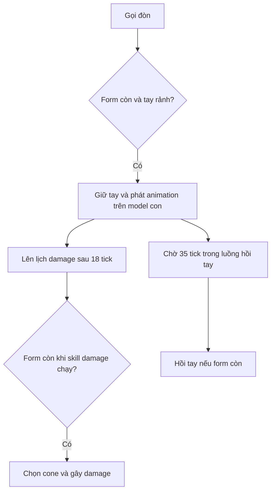

# Đồng bộ animation và thời điểm damage

Đặt mốc chạm đòn của animation cạnh mốc thực thi hitbox. Ví dụ chính là **Lục Cốt Chi Vương**, nơi model con phát animation còn người chơi thực thi skill damage.

## Khi dùng và khi tránh

- Dùng cho đòn có wind-up đọc được, cửa né hoặc nhịp chạm cần khớp với animation.
- Tránh dùng delay cố định làm nguồn timing duy nhất nếu tốc độ animation thay đổi theo buff hoặc hit phải theo vị trí vũ khí trên từng frame. Trong các ca đó, trước tiên xác định mốc có thể đo hoặc tín hiệu animation được build hỗ trợ.

## Luồng thực thi

**INFERENCE.** Người chơi gọi đòn. Skill kiểm tra form và tay còn rảnh, rồi dùng `SudoSkill` phát state trên model con. Dòng kế tiếp lên lịch skill damage ở tick 18. Skill damage xét form và chọn entity trong cone. Luồng hồi tay chờ 35 tick tính từ dòng chờ trong chuỗi gọi và chỉ ghi lại availability nếu form còn. Mốc hiển thị trên client và chính sách đổi hướng sau khi bắt đầu đòn cần xác minh riêng. [Luồng tay trái](../../incoming/Tutien/luccotchivuong/lccv_skills.yml#L19)



## Thành phần

- **FACT · wiki.** `state` điều khiển animation ModelEngine, có tốc độ và thời gian chuyển state. `delay` làm mechanic dịch lịch khi dùng như thuộc tính và dời phần tiếp theo của skill tree khi dùng dưới dạng mechanic. `SudoSkill` đổi caster cho metaskill được gọi. [ModelEngine State](https://wiki.mythiccraft.io/modelengine/Skills/Mechanics/State), [Delay](https://wiki.mythiccraft.io/mythicmobs/skills/mechanics/delay), [SudoSkill](https://wiki.mythiccraft.io/mythicmobs/skills/mechanics/sudoskill)
- **FACT · YAML và model.** `@Children` lọc theo `mythicmobtype`; child chạy `taytraiattack`, trong khi damage kiểm tra `hasAura` và gọi `mmodamage` trên `@EIC{a=225;r=6.5}`. Các tên state tay trái, phải và hai tay có trong asset. [Skill damage](../../incoming/Tutien/luccotchivuong/lccv_skills.yml#L53), [BBModel](../../incoming/Tutien/luccotchivuong/luccotchivuong.bbmodel)

## Ưu, nhược điểm và rủi ro

- **INFERENCE.** Các mốc tách riêng giúp kiểm tra hit và recovery độc lập. Thay đổi speed, lerp hoặc model có thể làm mốc 18 tick lệch khỏi điểm chạm. Cone chọn theo caster cần thử khi người chơi xoay giữa wind-up và hit. Nếu model chưa được chọn, damage vẫn cần được thử để xác định có xảy ra đòn thiếu telegraph.
- **INFERENCE.** Đo ở hai góc nhìn và nhiều caster. Kiểm tra lag, lệnh bị ngắt, form hết rồi tái tạo trước tick hồi tay, ally/pet đứng trong cone và mỗi caster có đúng model con. Biểu đồ này mô tả timing gameplay. Hủy event vanilla có yêu cầu thực thi riêng. [Đồng bộ event](huy-event-dong-bo.md)

## Trích YAML gốc

```yaml
  - skill{s=lccv_danhthuong_Attack_DAMAGE;delay=18}

  - delay 35
  - setvariable{var=caster.lccv_hand_1_availability;value=1} @caster ?hasAura{auraName=luccotchivuong}
  - variableadd{var=caster.lccv_hand_count;value=1} @caster ?hasAura{auraName=luccotchivuong}
```

[Dòng gốc của đòn tay trái](../../incoming/Tutien/luccotchivuong/lccv_skills.yml#L30)

## Xác minh và phương án khác

**FACT · bằng chứng.** YAML đạt `syntax-checked`, đã đối chiếu ID metaskill và tên state. Chưa có video đo tick chạm, HP trước/sau hay build. Thử xoay người, ngắt cast, thay tốc độ và đo tick damage cùng frame chạm. [Báo cáo Lục Cốt](../dataset-batch-01.md#lục-cốt-chi-vương)

**INFERENCE · phương án.** Dùng một metaskill có chuỗi state → delay → hit khi chỉ có một caster và một timeline. Tách skill hit khi nhiều biến thể tay dùng chung công thức hoặc khi model con và chủ thực thi các vai trò khác nhau. Nếu timing biến đổi theo animation, chỉ chọn cơ chế callback/keyframe sau khi xác nhận addon và phiên bản có hook phù hợp.
