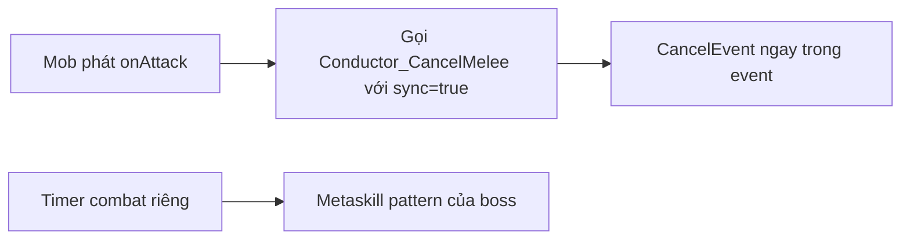

# Hủy event đồng bộ trước chuỗi combat tùy chỉnh

Hủy event nguồn ngay lúc trigger chạy để một hit vanilla không diễn ra song song với combat được điều khiển bằng metaskill. **Conductor** có một nhánh hủy melee và các nhánh combat theo timer riêng.

## Khi dùng và khi tránh

- Dùng khi gameplay yêu cầu thay thế một event có thể hủy, ví dụ boss đánh bằng pattern riêng.
- Tránh gắn `sync=true` vào toàn bộ các nhánh chỉ để canh animation. Nếu cần giữ đòn vanilla, dùng event để quan sát hoặc thêm VFX với phạm vi rõ.

## Luồng thực thi



**INFERENCE.** Conductor tách nhánh hủy `~onAttack` khỏi các chuỗi projectile/timer. Khi tái sử dụng cho đòn có wind-up, giữ bước hủy trong callback hiện tại rồi kiểm tra nhánh combat ở mốc damage riêng. Cần theo dõi các listener khác cùng event và nguy cơ damage tùy chỉnh kích lại đường `~onAttack`. [Mob Conductor](../../incoming/no-model/MythicMobsCariMc/MythicMobs/packs/PixelBarrel%27s%20Hollow%20Woods%20Vol.2/Mobs/Conductor.yml#L19)

## Thành phần

- **FACT · wiki.** `CancelEvent` yêu cầu mechanic hoặc skill đầu tiên chạy sync và hủy trước mọi delay. `~onAttack` nằm trong danh sách trigger được hỗ trợ. Các mechanic khác nghe cùng trigger vẫn có thể chạy. Skill tree giữ dữ liệu event nguồn. [CancelEvent](https://wiki.mythiccraft.io/mythicmobs/skills/mechanics/cancelevent), [Skill Trees](https://wiki.mythiccraft.io/mythicmobs/Skills/SkillTrees)
- **FACT · YAML.** Dòng gọi từ mob dùng `skill`, `sync=true` và `~onAttack`. Skill đích chỉ có `CancelEvent`. Nhánh này xử lý event nên không khai báo targeter riêng. Các nhánh theo timer có quy tắc chọn mục tiêu độc lập. [Metaskill hủy](../../incoming/no-model/MythicMobsCariMc/MythicMobs/packs/PixelBarrel%27s%20Hollow%20Woods%20Vol.2/Skills/Conductor_skills.yml#L1)

## Ưu, nhược điểm và rủi ro

- **INFERENCE.** Nhánh hủy ngắn giúp truy nguyên hit vanilla. Các plugin damage có thể tham gia cùng event, nên kết quả HP, miễn nhiễm và số trigger cần đo trên bộ plugin thực. Giữ tải trong phần xử lý event nhỏ và kiểm tra cấu hình `triggerSkills` trước khi kết nối damage quay lại trigger. [Damage và trigger trong changelog](https://wiki.mythiccraft.io/mythicmobs/changelogs/Changelogs?version_id=d7c47c878837c833a7602dcf02bca7b9b87056dd#damage)

## Trích YAML gốc

```yaml
  - skill{s=Conductor_CancelMelee;sync=true} ~onAttack
```

[Điểm gọi trên mob](../../incoming/no-model/MythicMobsCariMc/MythicMobs/packs/PixelBarrel%27s%20Hollow%20Woods%20Vol.2/Mobs/Conductor.yml#L19)

## Xác minh và phương án khác

**FACT · bằng chứng.** Hai đầu tham chiếu có trong đợt và đạt `syntax-checked`. Chưa thử nạp plugin hoặc nhận damage. Cần đo một hit vanilla, một hit tùy chỉnh, event bị hủy bởi plugin khác và hai người bị nhắm gần nhau. [Phân tích Conductor](../dataset-batch-01.md#conductor)

**INFERENCE · phương án.** Nếu chỉ cần hủy một event và build hỗ trợ trigger đó, có thể dùng mechanic trực tiếp ở dòng mob theo wiki. Nếu mob dùng AI và trigger riêng cho toàn bộ chiến đấu, cân nhắc bỏ nguồn melee tại AI nếu việc đó vẫn bảo toàn aggro và hành vi cần có. [CancelEvent](https://wiki.mythiccraft.io/mythicmobs/skills/mechanics/cancelevent), [Cấu hình AI của mob](https://wiki.mythiccraft.io/mythicmobs/Mobs/Mobs#aigoalselectors)
