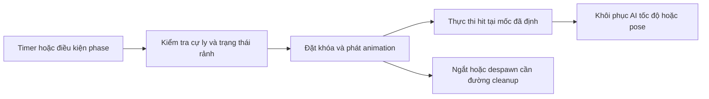

# Khóa hành động trong wind-up và trả trạng thái khi kết thúc

Dùng cho boss có wind-up rõ, cần chặn hai đòn chạy đồng thời và giữ nhịp animation. Với mob đánh nhanh có một đòn duy nhất, một cooldown và một mốc hit có thể đủ nếu không cần giữ pose hoặc ngắt AI.

**FACT · YAML.** Wu dùng `offgcd` trước đòn và `gcd` trong chuỗi, có các điểm `setAI` và model `state`. Cinder dùng một aura cho đòn đang chạy và nhiều `hasaura false` làm guard, `setspeed` ở đầu/cuối, dash có `lockmodel` rồi mở lại. Hai cách giữ dữ liệu trạng thái khác nhau, dù cả hai tách mốc khóa khỏi mốc hit. [Wu Slash](../../incoming/no-model/MythicMobsCariMc/MythicMobs/packs/Unrivalled_Vol.1_Wu/Skills/unrivalled_wu.yml#L191), [Armor Boss ZIP và dòng nguồn](../dataset-batch-03.md#armor-boss--ba-mob-chiến-đấu-advancedexpert)

**INFERENCE · chọn giải pháp.** Một khóa chung hợp khi mọi đòn loại trừ nhau; aura riêng hữu ích khi cần biết đòn nào đang chạy hoặc mở ngoại lệ có chủ ý. Nhiều aura riêng làm tăng số guard khi thêm skill. Nếu dùng khóa chung, kiểm tra cả hành vi phòng thủ và chuyển phase để tránh chặn nhầm nhánh cần chạy. Đặt bảng thời gian cho trạng thái rảnh, hit, recovery và xử lý ngắt. Khôi phục giá trị dự kiến của phase hiện hành sau khi xác nhận cách điều khiển AI và model trên build mục tiêu.

**Kiểm chứng.** Hai cụm đã parse YAML và đối chiếu cạnh literal. Chưa có bằng chứng runtime. Thử một đòn đang chạy khi boss chết, hai timer đến cùng lúc, phase đổi trong recovery và boss mất target. Kiểm tra AI, speed, model lock, số lần trúng và thực thể phụ còn sống sau reset. [Đợt 03](../dataset-batch-03.md)
