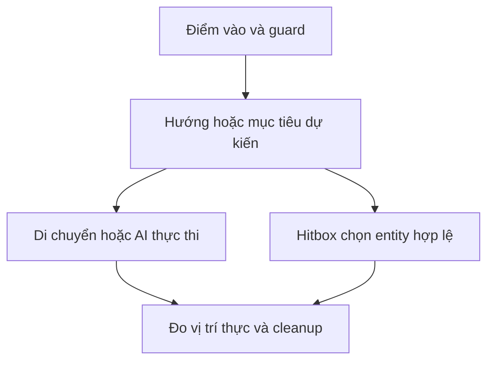

# Tách di chuyển, AI chọn mục tiêu và hitbox

Dùng khi chuyển động là phần gameplay, ví dụ dash có cửa trúng, boss đổi vị trí hay clone có AI riêng. Với đòn chỉ gây damage theo vùng, giữ cấu hình vùng đơn giản nếu không có yêu cầu di chuyển thực.

**FACT.** Xích Huyết gọi `lunge` rồi projectile riêng cho dash. Clone Arctic khai báo AI melee và target players. Wiki phân biệt AI goal, AI target và targeter của skill. [Dash Xích Huyết](../../incoming/Tutien/xichhuyetphathienthuong/xichhuyetthienthuong_skill.yml#L94), [Clone Arctic](../../incoming/no-model/MythicMobsCariMc/MythicMobs/mobs/ArcticKnightMobs.yml#L33), [Lunge](https://wiki.mythiccraft.io/mythicmobs/Skills/Mechanics/lunge), [Mob AI](https://wiki.mythiccraft.io/mythicmobs/Mobs/Mobs#aigoalselectors)

**INFERENCE.** Caster và projectile có thể đi khác quãng đường khi gặp tường, góc dốc hoặc đổi hướng. Kiểm tra VFX, đường đi và damage riêng. Dùng AI mặc định nếu nó đã đúng yêu cầu. Tách goal/target riêng khi cần luật aggro hoặc melee cụ thể, rồi đo pathfinding khi nhiều add. Các YAML mẫu chỉ được kiểm tra tĩnh. [Phân tích đợt 01](../dataset-batch-01.md)
