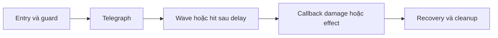

# Chia skill nhiều giai đoạn theo điểm vào và callback

Dùng khi wind-up, thực thi, tác động và recovery có timing hoặc target khác nhau. Một hành động độc lập có thể đặt trực tiếp trong dòng mob hoặc một metaskill ngắn.

**FACT.** Vạn Kiếm dùng entry, wave, projectile và impact riêng. Lục Cốt lên lịch skill damage bằng delay trên dòng gọi, đồng thời có luồng hồi tay riêng. Wiki phân biệt delay trên một dòng với mechanic Delay làm dời phần tiếp theo của cây. [Vạn Kiếm](../../incoming/Tutien/kiemtuytong/vankiemquytong/vkqt_skill.yml#L1), [Lục Cốt](../../incoming/Tutien/luccotchivuong/lccv_skills.yml#L19), [Delay](https://wiki.mythiccraft.io/mythicmobs/skills/mechanics/delay)

**INFERENCE.** Dùng metaskill có tên cho giai đoạn có guard riêng hoặc được gọi lại. Nếu chuỗi chỉ có một cảnh báo và một hit, giảm số lớp gọi để dễ truy. Với nhiều giai đoạn, kiểm tra kế thừa target, giá trị modifier, việc cast cũ chạy sau reset và tổng fan-out khi repeat. Chưa có test server cho các mẫu. [Hồ sơ timing](dong-bo-animation-damage.md), [Hồ sơ hiệu năng](toi-uu-timer-va-callback.md)
