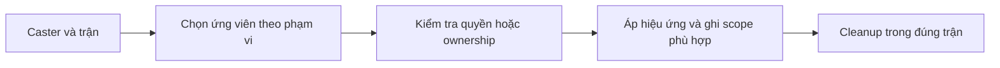

# Cô lập target, ownership và trạng thái trong multiplayer

Dùng khi có nhiều caster hoặc nhiều trận trong một vùng. Kiểm tra riêng quyền áp hiệu ứng, owner của thực thể và phạm vi biến.

**FACT.** Sacred Ward dùng `SUPPORT_ACTION`. Vạn Kiếm dùng `OFFENSE_ACTION`. Recall của Xích Huyết chọn child rồi kiểm tra owner của trigger. Conductor có đường teleport qua marker theo loại và bán kính. [Sacred Ward](../../incoming/no-model/fullclass/0_VipClass/Assistant/MythicMobs/Skills/AssistantSkill.yml#L262), [Vạn Kiếm](../../incoming/Tutien/kiemtuytong/vankiemquytong/vkqt_skill.yml#L38), [Recall](../../incoming/Tutien/xichhuyetphathienthuong/xichhuyetthienthuong_skill.yml#L210), [MythicLib](https://docs.phoenixdevt.fr/mythiclib/skills/custom/mythic)

**INFERENCE.** Dùng guard theo quan hệ cho support/offense và owner/parent cho summon. Chỉ dùng vùng đơn giản nếu mọi entity trong vùng đều hợp lệ theo luật. Thử hai người đứng sát nhau, hai boss cùng loại, đổi party/world giữa cast, hai lượt hit cùng tick và cleanup chỉ dọn entity của đúng trận. Điều kiện inline và chính sách MythicLib cần đối chiếu edition, build và plugin bảo vệ vùng. Chưa có kết quả multiplayer trên server. [Summon và owner](summon-owner-cleanup.md), [Điều kiện](conditional-skills.md)
