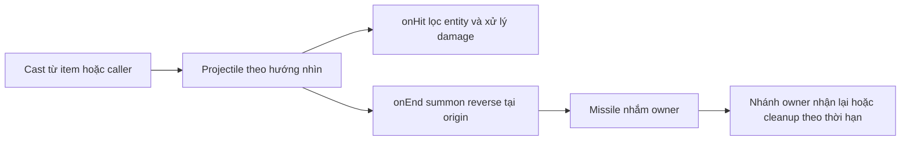

# Projectile khứ hồi về owner

Dùng khi đường đi và đường về là hai nhịp gameplay có thể quan sát, ví dụ lưỡi hái đi thẳng và quay lại theo vị trí người ném. Với đòn một lượt hoặc chỉ cần VFX quay về, có thể kết thúc hitbox ở nhánh đi và giảm số thực thể/callback.

**FACT · cấu hình.** Spirit Surge gọi `projectile` có `oH`, `oT`, `oE` và `@Forward`; nhánh kết thúc summon reverse tại `@Origin` với `sio=true`. Reverse có `missile ... @owner` và `remove{delay=100}`. Callback nhận phân nhánh theo `owner castinstead`. [Projectile và callbacks](../../incoming/no-model/MythicMobsCariMc/MythicMobs/packs/EC_soul_Weaver/Skills/EC_SoulWeaver_Scythe.yml#L122), [Reverse mob](../../incoming/no-model/MythicMobsCariMc/MythicMobs/packs/EC_soul_Weaver/Mobs/EC_SoulWeaver_FXS_Mobs.yml#L86)

**FACT · tài liệu.** Projectile có callback theo nhịp, va chạm và kết thúc. Missile có thể bám entity mục tiêu. Build nguồn chưa rõ, nên dùng tài liệu làm căn cứ thiết kế và chạy thử alias trên build cần dùng. [Projectile](https://wiki.mythiccraft.io/mythicmobs/skills/mechanics/projectile), [Missile](https://wiki.mythiccraft.io/mythicmobs/skills/mechanics/missile)

**INFERENCE · đánh đổi.** Hai giai đoạn cho phép bộ lọc và damage khác nhau, đổi lại phải theo dõi owner, caster và origin khi tạo reverse. Nếu có vùng kéo linh hồn chung, so khớp owner hoặc dấu nhận diện lượt cast theo yêu cầu gameplay trước khi kéo. Với đường về cố định, nhánh đạn thứ hai hướng về điểm đã lưu là phương án đơn giản hơn nếu người chơi không cần di chuyển để nhận.

**Kiểm chứng.** YAML đã parse, có khớp ID tĩnh cho các callback tách tên. Thử ném xuyên nhiều mục tiêu, owner rời world, hai người ném cùng chỗ, số lần hit trên cả hai lượt và số entity còn sau 100 tick. [Đợt 02](../dataset-batch-02.md)
