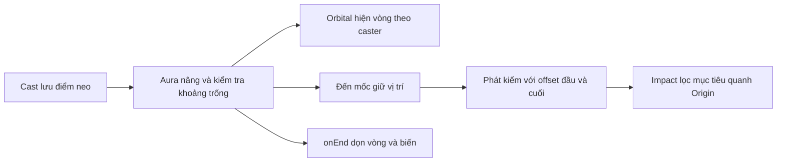

# Neo caster, vòng báo và loạt projectile

Dùng cho kỹ năng có ba nhịp rõ ràng gồm nâng người thi triển, báo hiệu trên không và phát đạn. Nếu người chơi vẫn được phép di chuyển, aura trên caster với projectile theo nhịp có thể đủ. Nếu vật thể gây sát thương đứng yên và caster được rời đi, cân nhắc Totem ở điểm đặt.

**FACT · cấu hình.** Vạn Kiếm Quy Tông lưu điểm neo qua `SetVariableLocation`, dùng aura và bộ đếm bước để nâng/giữ, orbital mob bullet hiển thị vòng và `@Forward` định hướng các kiếm. Mỗi kiếm lấy offset bằng `random(min,max)`. Impact tạo hiệu ứng tại `@origin`, lọc mục tiêu qua MythicLib và gọi damage. [YAML của ca Vạn Kiếm](../../examples/advanced/vankiemquytong-airborne/vkqt_skill.yml), [Math snapshot](../../docs/wiki/MythicMobs/Skills/Math.md), [Projectile online](https://wiki.mythiccraft.io/mythicmobs/skills/mechanics/projectile)

**INFERENCE · đánh đổi.** Hai offset độc lập tạo độ phủ rộng và vẫn giữ mỗi đường bay thẳng khi không dùng trọng lực hay homing. Gộp tốc độ bắn và cập nhật vị trí vào cùng aura giúp cùng một callback dọn dữ liệu khi cast kết thúc. Nếu bắn và nâng dùng lịch khác nhau, bảo đảm cả hai nhánh đều kiểm tra lượt cast còn hiệu lực. Kiểm tra va chạm của player ở chân/thân/đầu và xác minh ngoại lệ riêng của anti-cheat trước khi dùng cập nhật teleport trong combat.

**Kiểm chứng.** Ví dụ đã parse và đối chiếu ID tĩnh. Tài liệu xác nhận các thành phần riêng. Cần kiểm tra hướng nhìn sau khi neo, offset ở build mục tiêu, hai caster cạnh nhau, cleanup khi ngắt và thời gian thực ở TPS thấp. [Hồ sơ kiểm thử](../../feedback/corrections/MM-2026-005.md)
