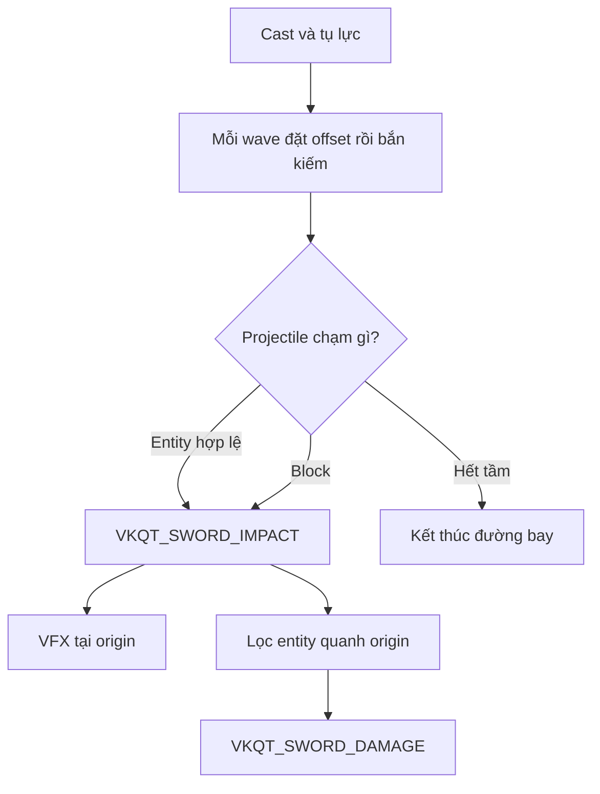

# Projectile có va chạm và AoE tại điểm trúng

Tách đường bay, phát hiện va chạm và xử lý damage thành các bước có thể kiểm tra riêng. Ví dụ chính là **Vạn Kiếm Quy Tông**, một đợt bắn nhiều kiếm có sát thương theo điểm va chạm.

## Khi dùng và khi tránh

- Dùng khi projectile có thời gian bay, có thể gặp tường hoặc mục tiêu di chuyển và phải tạo hiệu ứng tại điểm va chạm.
- Tránh khi đòn phải tác động tức thời hoặc vùng damage đã được xác định bởi một hitbox cận chiến. Nếu yêu cầu xuyên qua tường hoặc chỉ đánh trúng một entity, xác định quy tắc đó trước khi dùng chung callback nổ.

## Luồng thực thi

**INFERENCE.** Entry tạo cảnh báo, đợi 30 tick rồi phát từng wave. Mỗi lượt bắn đặt offset ngẫu nhiên và hướng tới `@forward`. Callback va chạm entity và callback va chạm block đều dẫn đến `VKQT_SWORD_IMPACT`. Skill đó phát VFX tại origin và chọn nhóm mới để áp damage. Hai lần chọn đối tượng phục vụ hai việc khác nhau. Mục tiêu bị kiếm chạm và nhóm chịu AoE có thể khác nhau. Điểm vào từ phía người chơi chưa nằm trong hai YAML đã đọc. [Entry, wave và projectile](../../incoming/Tutien/kiemtuytong/vankiemquytong/vkqt_skill.yml#L1)



## Thành phần

- **FACT · wiki.** `projectile` có interval cập nhật, bán kính ngang/dọc, tầm tối đa, điều kiện va chạm và callback riêng cho entity, block và kết thúc. Callback `onHit` nhận entity trúng. `tickinterpolation` thêm điểm nội suy giữa các lần cập nhật và có thể chạy kiểm tra hit cùng callback tick tại các điểm đó. `highAccuracyMode` (`ham`) là thuộc tính riêng để ray trace theo tick. [Projectile](https://wiki.mythiccraft.io/mythicmobs/skills/mechanics/projectile)
- **FACT · YAML.** Đường kiếm dùng `i=1`, `v=32`, `mr=32`, `hR=0.55`, `vR=0.7`, `tickinterpolation=2`, `ham=true`, `sE=true` và `sB=true`. `@EntitiesNearOrigin` dùng r=2.5, sort gần nhất, limit 8 và lọc entity sống, armor stand, quyền tấn công. Damage gọi `mmodamage`. Model dùng mob bullet với ModelEngine. [Dòng projectile](../../incoming/Tutien/kiemtuytong/vankiemquytong/vkqt_skill.yml#L25), [Mob VFX](../../incoming/Tutien/kiemtuytong/vankiemquytong/vkqt_mobs.yml), [MythicLib](https://docs.phoenixdevt.fr/mythiclib/skills/custom/mythic)

## Ưu, nhược điểm và rủi ro

- **INFERENCE.** Tách callback cho phép đổi model hoặc particle mà vẫn giữ được vị trí kiểm tra damage. Nhiều kiếm chạm gần nhau có thể gọi AoE nhiều lần lên cùng người. Giới hạn 8 là trên một lần chọn, vì vậy cần đo tổng số hit trong cả wave.
- **INFERENCE.** Tốc độ, kích thước hitbox và nội suy tác động đồng thời tới độ chính xác lẫn chi phí. Đo số callback/tick khi nhiều caster, kiểm tra tường mỏng và mục tiêu chạy ngang. Hai model ID của Vạn Kiếm chưa đối chiếu được với tên model rời đã đọc. Xác nhận ID được ModelEngine nạp. Wiki đánh dấu một số điều kiện projectile là Premium. [Projectile](https://wiki.mythiccraft.io/mythicmobs/skills/mechanics/projectile), [Hồ sơ đợt 01](../dataset-batch-01.md#vạn-kiếm-quy-tông)

## Trích YAML gốc

```yaml
  - projectile{bulletType=MOB;mob=VFX_VKQT_SWORD;bmd=true;oT=VKQT_SWORD_TICK;oH=VKQT_SWORD_IMPACT;ohb=VKQT_SWORD_IMPACT;v=32;i=1;mr=32;hR=0.55;vR=0.7;hp=true;hnp=true;sE=true;sB=true;hs=false;sfo=1.5;sso=<skill.var.vkqt_side>;eso=<skill.var.vkqt_side>;syo=<skill.var.vkqt_up>;tyo=<skill.var.vkqt_up>;fo=false;rlos=false;tickinterpolation=2;drawhitbox=false;ham=true;hitConditions=[- isLiving true - mmoCanTarget{interaction=OFFENSE_ACTION} true]} @forward{f=32;y=0;lockpitch=true}
```

[Dòng projectile gốc](../../incoming/Tutien/kiemtuytong/vankiemquytong/vkqt_skill.yml#L29), [Callback va chạm và damage](../../incoming/Tutien/kiemtuytong/vankiemquytong/vkqt_skill.yml#L38)

## Xác minh và phương án khác

**FACT · bằng chứng.** Hai YAML đã đạt `syntax-checked`. Các ID skill và mob bullet được đối chiếu trong đợt. Chưa có build, log nạp hay số liệu hit. Thử riêng va chạm entity, tường, hết tầm, mục tiêu đồng minh và hai caster cùng bắn. Ghi origin thực tế và số lần damage. [Chỉ mục đợt 01](../dataset-index.md)

**INFERENCE · phương án.** Dùng damage ngay trong `onHit` với target kế thừa nếu yêu cầu là chỉ trúng đối tượng bị va chạm. Dùng ray trace khi gameplay cần kết quả tức thời theo đường ngắm và đã xác nhận edition phù hợp. Với projectile cần thời gian bay và phát nổ tại điểm chạm, giữ callback va chạm và lần chọn AoE tách riêng. [Projectile](https://wiki.mythiccraft.io/mythicmobs/skills/mechanics/projectile), [Premium Features](https://wiki.mythiccraft.io/mythicmobs/Premium-Features?version_id=28b903e755156108c8d4483e7bb8294bb5274605)
