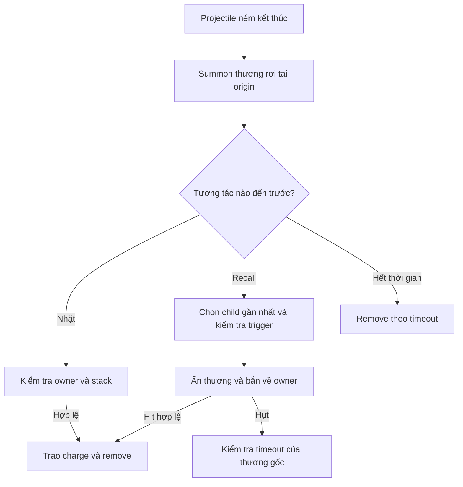

# Summon có chủ sở hữu và đường cleanup

Theo dõi entity được tạo, chủ sở hữu, quan hệ parent/child và các đường kết thúc. **Xích Huyết Phá Thiên Thương** cho ví dụ thương rơi có thể nhặt hoặc thu hồi. **Conductor** cho ví dụ dọn mob phụ khi boss chết.

## Khi dùng và khi tránh

- Dùng khi thực thể phải tồn tại sau lượt cast, nhận tương tác hoặc có vòng đời riêng theo chủ sở hữu.
- Tránh dùng một mob sống lâu chỉ để hiện particle hoặc slash ngắn nếu hiệu ứng trực quan sẵn có đáp ứng yêu cầu. Tránh quét theo loại và bán kính để xóa mob phụ khi hai trận có thể ở sát nhau.

## Luồng thực thi

**INFERENCE.** Projectile ném thương kết thúc thì summon thương rơi tại origin. Mob rơi có cửa nhặt dự kiến 240 tick. Nhặt kiểm tra owner và số stack rồi trao charge, phát âm thanh và remove. Recall chọn child gần nhất đúng loại, xét owner ở trigger, gắn khóa ngắn lên trigger và đổi model sang trạng thái ẩn trước khi bắn về owner. Hit về owner dùng callback trao charge rồi remove mob gốc. Nếu đường bay hụt, timeout của entity gốc là đường cleanup cần xác nhận. [Throw và pickup](../../incoming/Tutien/xichhuyetphathienthuong/xichhuyetthienthuong_skill.yml#L141), [Recall](../../incoming/Tutien/xichhuyetphathienthuong/xichhuyetthienthuong_skill.yml#L210)



## Thành phần

- **FACT · wiki.** `summon` có thuộc tính cho owner và parent. `owner` kiểm tra quan hệ của đối tượng được xét với caster. `SudoSkill` đổi caster thành entity được chọn và `setcasterastrigger` đưa caster ban đầu vào trigger. `@Children` và `@Owner` đọc hai quan hệ riêng. [Summon](https://wiki.mythiccraft.io/mythicmobs/skills/mechanics/summon), [Owner](https://wiki.mythiccraft.io/mythicmobs/skills/conditions/owner), [SudoSkill](https://wiki.mythiccraft.io/mythicmobs/skills/mechanics/sudoskill), [Targeters](https://wiki.mythiccraft.io/mythicmobs/Skills/Targeters)
- **FACT · YAML.** Nguồn dùng `sio=true;sip=true`, `@origin`, `@Children`, `@Owner`, `owner`, `hasaurastacks`, `hasAura`, `mythicmobtype`, `distance`, projectile đứng yên, `defaultstate` và `remove`. VFX dùng ModelEngine. Conductor dùng `remove @Children ~onDeath` và có cả mob phụ spawn bằng lệnh. [Mob thương rơi](../../incoming/Tutien/xichhuyetphathienthuong/xichhuyetthienthuong_mobs.yml#L106), [Cleanup Conductor](../../incoming/no-model/MythicMobsCariMc/MythicMobs/packs/PixelBarrel%27s%20Hollow%20Woods%20Vol.2/Mobs/Conductor.yml#L18)

## Ưu, nhược điểm và rủi ro

- **INFERENCE.** Hai quan hệ giúp truy entity đúng người trong multiplayer. Khóa recall 2 tick và giới hạn một child có thể giảm gọi chồng, cần thử pickup và recall cùng tick để biết có nhận charge hai lần. Thử logout, đổi world, unload chunk và thương ẩn sau recall hụt.
- **INFERENCE.** Mỗi thương rơi có thể duy trì cả model và phép kiểm tra hit theo tick. Đo số instance đồng thời và thời gian entity tồn tại sau kết thúc. Với spawn bằng lệnh, xác nhận quan hệ parent/child thay vì suy từ tên mob. Build/edition cần khớp nếu dùng `hitConditions` của projectile. [Projectile](https://wiki.mythiccraft.io/mythicmobs/skills/mechanics/projectile)

## Trích YAML gốc

```yaml
xichhuyetthienthuong_Throw_END:
  Skills:
  - summon{type=VFX_XHPTT_DROPPED_SPEAR;amount=1;radius=0;yRadius=0;onSurface=true;sio=true;sip=true} @origin
```

[Callback summon trong nguồn](../../incoming/Tutien/xichhuyetphathienthuong/xichhuyetthienthuong_skill.yml#L141)

## Xác minh và phương án khác

**FACT · bằng chứng.** Cặp YAML đạt `syntax-checked`, các cạnh summon, mob spawn và skill đã đối chiếu. Chưa có log nạp hay bằng chứng pickup/recall. Thử hai caster, hai thương cạnh nhau, chủ đã đủ stack và từng đường hết hạn hoặc bị ngắt. [Báo cáo Xích Huyết](../dataset-batch-01.md#xích-huyết-phá-thiên-thương)

**INFERENCE · phương án.** Nếu entity chỉ đi theo trong một hiệu ứng có thời lượng, khảo sát orbital như mẫu Lục Cốt và kiểm tra cleanup khi aura kết thúc. Nếu gameplay chỉ cần vật phẩm rơi có chủ và dùng bản hỗ trợ, khảo sát `dropitem` với owner từ changelog 5.14.0. Trường hợp cần recall theo đường bay và charge giữ luồng entity + callback vì vật phẩm rơi có vòng đời khác. [Lục Cốt orbital](../../incoming/Tutien/luccotchivuong/lccv_backgroung.yml#L1), [DropItem Owner 5.14.0](https://wiki.mythiccraft.io/mythicmobs/changelogs/Changelogs?version_id=d7c47c878837c833a7602dcf02bca7b9b87056dd)
