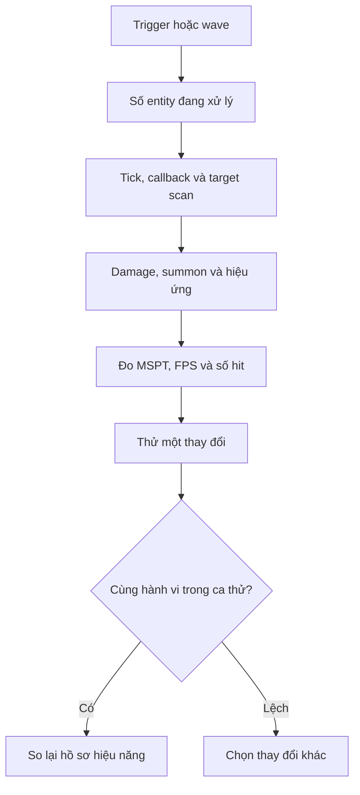

# Tối ưu timer, projectile và callback theo tải đo được

Giảm phần việc lặp trong combat mà vẫn giữ đúng nhịp, đối tượng và số hit. **Vạn Kiếm Quy Tông** cho ca tải theo wave, **Conductor** cho ca timer và add, **Assistant** cho ca particle lặp.

## Khi dùng và khi tránh

- Dùng khi tải tăng theo số caster, số projectile, ứng viên targeter hoặc số effect. Tách phép đo server và client.
- Tránh bắt đầu bằng thay đổi interval toàn server khi chưa xác định điểm nóng. Tránh giảm nội suy, bán kính, số wave hoặc mật độ telegraph nếu những giá trị đó là một phần hành vi cần giữ.

## Luồng thực thi và đo



**INFERENCE.** Với Vạn Kiếm, 24 wave × 4 lời gọi cho tối đa 96 lượt gọi projectile theo cấu hình lặp và giả định mọi lượt đều chạy. Conductor có nhánh Vioar kiểm tra qua timer 5 tick, với một nhánh ring 60 điểm. Hai số này là khối lượng cấu hình của hai ví dụ, chưa phải số entity đồng thời hay kết quả benchmark. [Wave Vạn Kiếm](../../incoming/Tutien/kiemtuytong/vankiemquytong/vkqt_skill.yml#L12), [Vioar timer](../../incoming/no-model/MythicMobsCariMc/MythicMobs/packs/PixelBarrel%27s%20Hollow%20Woods%20Vol.2/Mobs/Conductor.yml#L55), [Ring Vioar](../../incoming/no-model/MythicMobsCariMc/MythicMobs/packs/PixelBarrel%27s%20Hollow%20Woods%20Vol.2/Skills/Conductor_skills.yml#L329)

## Thành phần

- **FACT · wiki.** `~onTimer` dùng đồng hồ chung. `repeatInterval` khai báo khoảng lặp. `projectile` có interval, range, duration và nội suy. `sort/limit` tác động tới danh sách target trả về. [OnTimer](https://wiki.mythiccraft.io/mythicmobs/Skills/Triggers/onTimer), [Mechanics](https://wiki.mythiccraft.io/mythicmobs/Skills/Mechanics#universal-attributes), [Projectile](https://wiki.mythiccraft.io/mythicmobs/skills/mechanics/projectile), [Target Limits](https://wiki.mythiccraft.io/mythicmobs/Skills/Targeters#target-limits)
- **FACT · YAML.** Vạn Kiếm dùng `skill` lặp, `@forward`, `@EntitiesNearOrigin` và `mmoCanTarget`. Vioar dùng condition `stance`, `@Ring` và projectile callback. Sacred Ward gọi riêng nhánh hỗ trợ và nhánh particle ở nhịp lặp khác nhau. [Sacred Ward](../../incoming/no-model/fullclass/0_VipClass/Assistant/MythicMobs/Skills/AssistantSkill.yml#L251)

## Ưu, nhược điểm và rủi ro

- **INFERENCE.** Đo theo nhóm giúp thử thay đổi ở phần VFX trước khi đụng hitbox nếu profiler cho thấy phần đó tốn nhất. Giảm tần suất quét có thể làm trễ nhận hiệu ứng, còn giảm nội suy có thể hụt entity nhanh. Giới hạn danh sách target giảm phần việc downstream, chi phí thu thập/sort cần đo riêng.
- **FACT · tương thích.** Changelog ghi 5.12.1 gom particle packets. Paper tích hợp spark từ 1.21. Kết quả giữa hai build có thể phản ánh cả thay đổi plugin và thay đổi YAML, nên lưu đúng build và chỉ đổi một yếu tố mỗi lượt đo. [Changelog MythicMobs](https://wiki.mythiccraft.io/mythicmobs/changelogs/Changelogs?version_id=d7c47c878837c833a7602dcf02bca7b9b87056dd), [Paper Profiling](https://docs.papermc.io/paper/profiling/)

## Trích YAML gốc

```yaml
  - skill{s=VKQT_WAVE;repeat=23;repeatInterval=10}
```

[Dòng lặp và bốn lượt gọi mỗi wave](../../incoming/Tutien/kiemtuytong/vankiemquytong/vkqt_skill.yml#L15)

## Xác minh và phương án khác

**FACT · bằng chứng.** Các YAML mẫu đạt `syntax-checked`. Chưa có hồ sơ spark hoặc client FPS. Lập hai lần đo cùng arena, số người, số mob và số cast. Ghi median/p95/max MSPT, FPS, số callback, hit, mốc telegraph và số entity còn lại sau cast. [spark TPS và MSPT](https://spark.lucko.me/docs/guides/TPS-and-MSPT), [Quy trình đo trong kho](../architecture/performance.md)

**INFERENCE · phương án.** Nếu một event mô tả đúng điều kiện thực thi, thử thay polling bằng event. Nếu polling cần thiết cho gameplay, giữ nhịp quét và thử giảm phạm vi ứng viên hoặc chi phí VFX. Nếu profiler chỉ ra projectile, đo thay đổi range/interval hoặc nội suy với bộ ca trúng, hụt và cản đường tương ứng.
