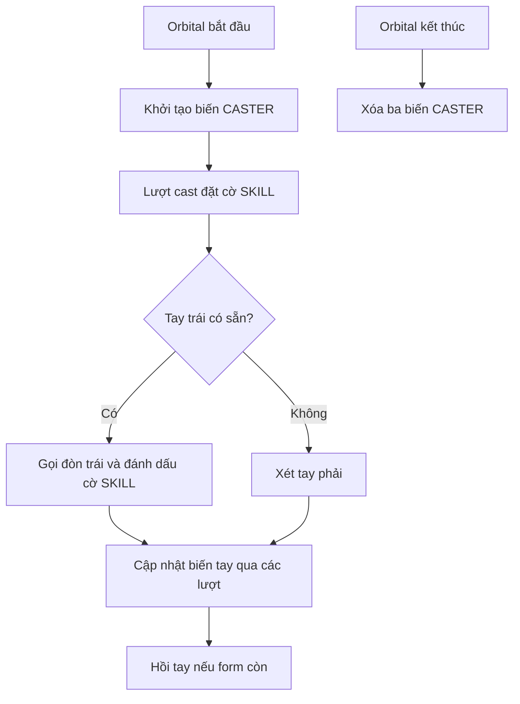

# Scope biến cho một lượt cast và trạng thái giữa các lượt

Dùng dữ liệu `SKILL` cho quyết định nội bộ một skill tree và `CASTER` cho trạng thái của cùng thực thể qua nhiều lần gọi. Ví dụ là cờ chọn nhánh và số tay rảnh của **Lục Cốt Chi Vương**, cùng offset projectile của **Vạn Kiếm Quy Tông**.

## Khi dùng và khi tránh

- Dùng khi một chuỗi cần truyền giá trị cho metaskill con, hoặc nhiều cast phải đọc trạng thái của riêng người chơi/boss.
- Tránh scope `WORLD` hoặc `GLOBAL` cho trạng thái vốn thuộc một caster. Tránh duy trì cả counter và nhiều cờ nếu chỉ một giá trị đã biểu diễn đầy đủ luật gameplay. Khi phải giữ cả hai, xác định bất biến và đường khởi tạo/reset.

## Luồng thực thi



**INFERENCE.** Cờ `skill.casted` giúp nhánh tay phải biết nhánh trái đã được chọn trong lượt hiện tại. `lccv_hand_count` và hai cờ tay thuộc form của caster. Bất biến cần thử là counter bằng tổng hai cờ. Vạn Kiếm ghi lại hai biến offset trước mỗi lần gọi projectile, vì vậy cần kiểm tra thời điểm projectile đọc offset nếu việc đọc xảy ra sau khi biến bị ghi tiếp. [Luồng Lục Cốt](../../incoming/Tutien/luccotchivuong/lccv_skills.yml#L2), [Form và cleanup](../../incoming/Tutien/luccotchivuong/lccv_backgroung.yml#L1), [Offset Vạn Kiếm](../../incoming/Tutien/kiemtuytong/vankiemquytong/vkqt_skill.yml#L25)

## Thành phần

- **FACT · wiki.** `SKILL` thuộc skill tree, `CASTER` thuộc caster, `TARGET` thuộc entity được xét. Metaskill trong cùng skill tree có thể truy cập biến `SKILL`. `branch` thay đổi cách thay đổi trong nhánh được truyền về cây cha. [Variables](https://wiki.mythiccraft.io/mythicmobs/Skills/Variables), [Skill Trees](https://wiki.mythiccraft.io/mythicmobs/Skills/SkillTrees), [Skill Branch](https://wiki.mythiccraft.io/mythicmobs/Skills/Mechanics/skill#branch-attribute)
- **FACT · YAML.** Lục Cốt dùng `setvariable`, `variableadd`, `variableUnset`, `varEquals`, `hasAura`, `skill`, `@caster` và callback `onStart/onEnd` của orbital. Vạn Kiếm dùng biến FLOAT và placeholder `<skill.var.…>` cho offset. [Khởi tạo và xóa](../../incoming/Tutien/luccotchivuong/lccv_backgroung.yml#L9), [Chọn nhánh](../../incoming/Tutien/luccotchivuong/lccv_skills.yml#L8)

## Ưu, nhược điểm và rủi ro

- **INFERENCE.** Scope hẹp làm rõ giá trị thuộc lượt hay thực thể. Counter và cờ có thể lệch nếu callback bị hủy, chạy nhiều lần hoặc ghi vào form mới sau khi form cũ hết. Thử hai cast gần nhau, aura hết và được tạo lại trước lúc hồi tay, hai caster có chung target và một cast dừng khi thiếu biến.
- **INFERENCE.** Nhiều lần đọc/ghi và condition trong chuỗi lặp cần đo khi đông người. Không dùng việc đổi scope để giải quyết hiệu năng nếu thay đổi đó làm gộp trạng thái giữa các caster. Kiểm tra hỗ trợ placeholder, scope và branch trên build trước khi chỉnh cấu hình.

## Trích YAML gốc

```yaml
  Skills:
  - setvariable{var=skill.casted;v=0} @caster
```

[Khởi tạo cờ của lượt cast](../../incoming/Tutien/luccotchivuong/lccv_skills.yml#L8)

## Xác minh và phương án khác

**FACT · bằng chứng.** File nguồn đạt `syntax-checked`. Đã xác định vị trí ghi, đọc và xóa biến trong YAML. Chưa đo thứ tự callback, va chạm giữa cast hoặc hành vi khi hủy. [Báo cáo Lục Cốt](../dataset-batch-01.md#lục-cốt-chi-vương)

**INFERENCE · phương án.** Dùng một aura hoặc stance khi chỉ cần biểu diễn một trạng thái đơn giản. Dùng các cờ tay và tính số tay rảnh từ cờ nếu build hỗ trợ thao tác cần thiết và không có caller nào cần giữ counter độc lập. Với dữ liệu tạm cần cô lập theo nhánh, xem `branch` rồi thử việc truyền giá trị đầu vào và kết quả trở về cây cha.
