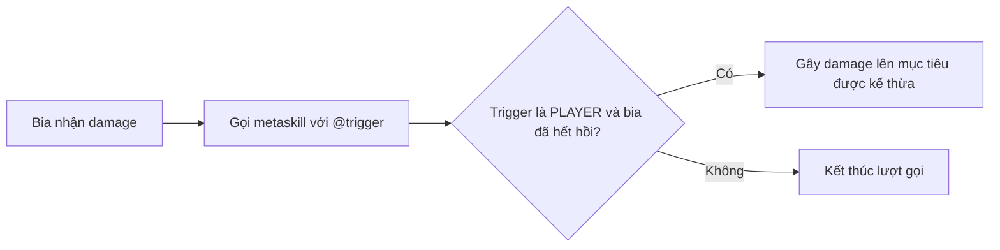

# Bài 001 · Bia phản kích khi bị đánh

**Trình độ cơ bản.** Khi người chơi đánh bia, bia trả sát thương về đúng người vừa đánh. Mỗi bia có cooldown riêng là 3 giây. Ca này tập trung vào đòn cận chiến trong Survival. Cơ chế xác định người bắn tên hoặc người gây sát thương gián tiếp nằm ngoài phạm vi bài.

## Tra cứu và lựa chọn

- Đã tra bộ nhớ theo chủ đề combat và cooldown. Quy tắc về độ phức tạp áp dụng khi hai phương án đáp ứng cùng gameplay. Metaskill dùng cooldown có sẵn, giữ được giới hạn theo từng bia mà không cần biến hoặc timer tự cập nhật. [Hồ sơ tư duy](../../../knowledge/learning-profile.md)
- Mẫu [TrainingGreeter](../../../examples/simple/) minh họa cách chia mob và metaskill thành hai file. Ca này thay luồng tương tác bằng luồng nhận damage để kiểm tra người gây sự kiện.
- **FACT · tài liệu**. `~onDamaged` gắn người gây damage vào ngữ cảnh trigger. `TriggerConditions` kiểm tra thực thể đó và `Cooldown` được tính theo giây cho cùng caster. [onDamaged](https://wiki.mythiccraft.io/mythicmobs/Skills/Triggers/onDamaged) · [EntityType](https://wiki.mythiccraft.io/mythicmobs/Skills/Conditions/EntityType) · [Metaskills](https://wiki.mythiccraft.io/mythicmobs/Skills/Metaskills)
- **FACT · tài liệu**. Mechanic bên trong metaskill kế thừa target đã chọn nếu không chỉ định targeter khác. [Metaskills · kế thừa target](https://wiki.mythiccraft.io/mythicmobs/Skills/Metaskills#targets-inheritance-and-override) · [Trigger targeter](https://wiki.mythiccraft.io/mythicmobs/Skills/Targeters/Trigger) · [Damage](https://wiki.mythiccraft.io/mythicmobs/Skills/Mechanics/damage)
- **INFERENCE · từ YAML**. Với cấu hình này, đòn cận chiến của A dự kiến làm bia phản kích vào A. Cần kiểm tra trên server rằng B đứng cạnh không bị trúng và việc B đổi vai với A cho kết quả tương ứng.
- Damage và thời gian hồi là thông số bài tập. Không có lựa chọn gameplay cá nhân mới cần lưu.



## Tự kiểm tra

- [Mob YAML](Mobs/counter-guard.yml) gọi [metaskill YAML](Skills/counter-guard.yml) bằng ID nội bộ. `entitytype{t=PLAYER}` áp dụng cho trigger. Không có biến hoặc trạng thái giữa các người chơi. Hai danh sách AI dùng `clear` để cô lập đòn phản kích khỏi AI đánh và chọn mục tiêu thông thường. [Custom AI](https://wiki.mythiccraft.io/mythicmobs/Mobs/Custom-AI)
- Sát thương cấu hình là 2. Bài chỉ có một tác vụ tức thời, không có delay, animation, hitbox riêng, projectile, summon hay tác vụ chờ cleanup. Cooldown thuộc caster là bia, vì vậy A có thể dùng lượt phản kích của bia trước khi B đánh. Bảng bên dưới kiểm tra trực tiếp điều này.
- Mốc đối chiếu là MythicMobs **5.14.0**, dùng cơ chế core, không khai báo addon. Chọn Minecraft/Paper tương thích với bản phát hành và ghi phiên bản thực tế, build và edition trước khi thử. Kết quả của một build chỉ áp dụng cho build đó. [Bản phát hành MythicMobs](https://hangar.papermc.io/Lumine/MythicMobs/versions/)

## Kiểm thử Minecraft

Chép hai file vào `Mobs/` và `Skills/` của bản sao server. Dùng hai người chơi Survival không mặc giáp, không có hiệu ứng bảo vệ, trong khu vực cho phép mob gây damage. Lưu log nạp và xác nhận ID mob cùng metaskill được đăng ký. Thực hiện các ca gần vị trí spawn, chờ qua cooldown giữa các ca và tránh dùng đòn khi bia đang trong khoảng miễn damage của Minecraft.

```text
/mm reload
/mm mobs list
/mm mobs spawn TrainingCounterGuard
```

[Lệnh MythicMobs](https://wiki.mythiccraft.io/mythicmobs/Commands-and-Permissions)

| ID | Thao tác | Kết quả kỳ vọng |
| --- | --- | --- |
| `melee` | A đánh bia một lần bằng tay không sau khi bia đã sẵn sàng. | A nhận đúng một đòn phản kích. Ghi chênh lệch máu thực tế. |
| `cooldown` | A đánh, đánh lại sau khoảng 1–2 giây, rồi đánh khi đã qua hơn 3 giây tính từ đòn đầu. | Đòn đầu và đòn cuối phản kích. Đòn ở giữa vẫn phải làm bia mất máu để chứng minh đã có sự kiện damage. |
| `two-players` | A đánh khi B đứng cạnh, B đánh sau khoảng 1–2 giây, rồi đánh lại khi đã qua hơn 3 giây tính từ đòn A. | A trúng trước. B đứng cạnh và lần đánh trong cooldown đều an toàn. B trúng khi bia đã hồi. |
| `two-mobs` | Spawn hai bia. A và B lần lượt đánh hai bia khác nhau trong cửa sổ dưới 3 giây, mỗi người đánh một bia. | Mỗi bia phản kích lượt đầu lên đúng người vừa đánh nó. |
| `environment` | Dùng một nguồn môi trường như xương rồng để bia thực sự mất máu khi A và B đứng cạnh. | Cả hai người chơi không nhận đòn phản kích. Ghi cách đã xác nhận bia mất máu. |
| `cleanup` | Chạy `/mm mobs kill TrainingCounterGuard` rồi `/mm mobs listactive`. | Không còn bia của bài này hoặc tác vụ nào do cấu hình bài tạo ra. |

**Checkpoint.** Xem trạng thái hiện tại bằng `tools/training.py status`. Các dòng trên mô tả kết quả kỳ vọng. Chưa có log nạp hoặc bằng chứng gameplay. Khi các ca đạt, bài tiếp theo sẽ thêm một khoảng báo trước để thử giữ đúng mục tiêu qua delay và kiểm tra hủy khi mob rời cuộc chiến.
